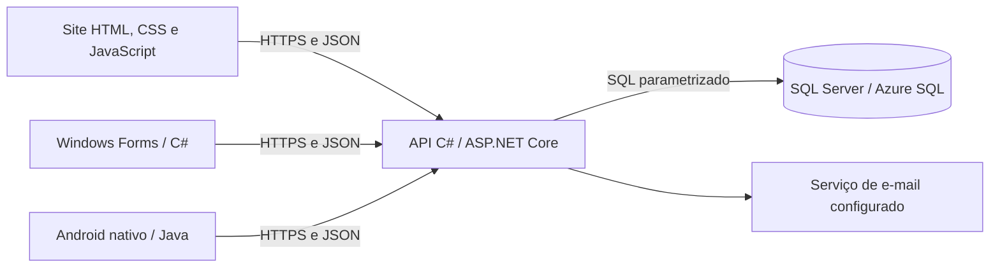

# Como o sistema funciona

## Responsabilidades

- **Interface:** apresenta os dados, confere campos e envia solicitações. O JavaScript usa `js/api.js`; o desktop usa `ApiCliente.cs`; o Android usa `Api.java`.
- **Controllers:** recebem as rotas HTTP e exigem a sessão e o perfil apropriados.
- **Serviços:** aplicam regras de usuários, cursos, avaliações e atendimento.
- **Modelos:** representam os dados e as regras de cada entidade.
- **ConexaoBanco:** abre a conexão configurada e executa consultas com parâmetros.
- **Banco:** mantém usuários, sessões, cursos, matrículas, materiais, avaliações e demais registros relacionados.

A API também serve os arquivos do site. Isso permite hospedar site e API no mesmo App Service e usar caminhos como `/api/usuarios` sem configurar um endereço diferente no navegador.

## Exemplo: entrar no sistema

1. A pessoa informa e-mail e senha na interface.
2. A interface envia os campos para a API por HTTPS.
3. A API procura a conta e compara a senha com o hash armazenado.
4. Uma sessão é criada quando os dados são válidos.
5. A interface apresenta o painel correspondente ao perfil recebido.
6. Nas próximas solicitações, a API continua conferindo sessão e permissão.

O navegador pode usar o cookie de sessão; os clientes nativos enviam o token conforme o contrato da API. O perfil não é escolhido pelo endereço de e-mail nem pelo menu.

## Autenticação e autorização

Autenticação responde quem está usando o sistema. Autorização decide se essa pessoa pode realizar a operação. Alterar o HTML ou esconder um botão não concede uma permissão: a verificação ocorre na API.

As senhas passam por hash com sal. Sessões e recuperação usam tokens; o banco guarda o hash dos tokens. Consultas SQL recebem parâmetros em vez de juntar os dados digitados diretamente na consulta.

## Hospedagem

O App Service executa a API e entrega o site. O Azure SQL guarda os dados. Serviços de comunicação do Azure também existem no grupo de recursos; a configuração e as chaves desses serviços pertencem ao ambiente de hospedagem.

GitHub guarda o código e os commits. Enviar um commit não atualiza automaticamente o Azure. O workflow deste repositório faz verificações e não tem credenciais de produção.
