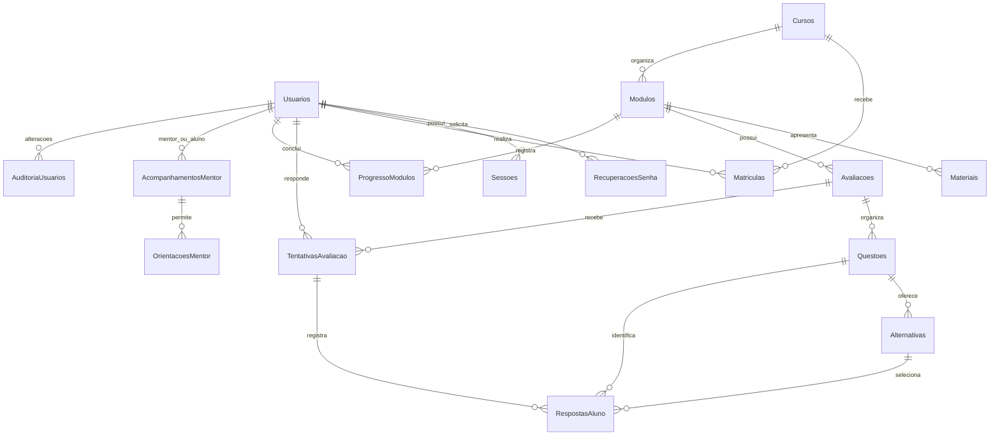

# Banco de dados — TechLearn Academy PIM IV

## Correção de 11/10/2026

Nesta instalação, aplicada Banco/07-corrigir-recuperacao-e-avaliacoes.sql após criar e verificar o backup .local/TechLearnAcademy_PIMIV-antes-integracao-Luis-20261011.bak.

- `Usuarios.EmailContato` tem índice único: um e-mail pessoal não pode pertencer a várias contas.
- `Matriculas.TentativaCurso` identifica a tentativa atual do curso.
- `TentativasAvaliacao.TentativaCurso` identifica em qual tentativa do curso a nota foi obtida.
- Reiniciar após reprovação aumenta o número na matrícula e remove o progresso dos módulos desse curso. As notas e respostas anteriores são preservadas. Solicitações de certificado ainda pendentes são recusadas, com o motivo do reinício; certificados já emitidos permanecem preservados.
- A API bloqueia a matrícula durante a correção e o reinício, impedindo envios simultâneos de avaliações repetidas. Não foram criadas tabelas ou classes novas.

## Atualização de 06/10/2026

O banco usado pelo site é **TechLearnAcademy_PIMIV** em **(localdb)\MSSQLLocalDB**.
A atualização **Banco/05-atualizar-funcionalidades.sql** foi aplicada a esse banco, preservando os cadastros.
A referência ao backup de 06/10 pertence ao computador do Luis. O backup desta instalação está na pasta .local da solução.

Foram adicionadas três tabelas: Chamados, MensagensChamado e SolicitacoesCertificado.
Usuarios ganhou EmailContato. Materiais ganhou ArquivoNome e ArquivoPdf. Curso, módulo, material e avaliação têm o campo Excluido.
O índice de ordem dos módulos permite reutilizar uma ordem após excluir um módulo.
A aplicação e a trigger impedem adicionar um quinto módulo ao mesmo curso.
O atendimento de mentor passa a ser autorizado pelos chamados assumidos. AcompanhamentosMentor permanece como histórico, sem uso no atendimento novo.
OrientacoesMentor continua registrando a orientação do mentor.

As nove classes principais permanecem. Tabelas de login, chamados e certificados dão suporte aos serviços.
Consulte [Guia das novas funções](novas-funcoes.md).

**Os resultados históricos de testes abaixo são anteriores a essa atualização e não comprovam os fluxos novos.**

## Banco usado pelo site e as nove classes

A configuração de desenvolvimento atual da API aponta para **TechLearnAcademy_PIMIV**, na instância **(localdb)\MSSQLLocalDB**. Esse é o banco criado por `Banco/Instalar-banco-do-site.sql`. O script original `01-criar-banco.sql`, descrito abaixo, usa o nome TechLearnAcademy.

A simplificação das classes preservou o banco. A inclusão de chamados, certificados e documentos exige a atualização 05.

| Classe do programa | Onde seus dados ficam no banco |
| --- | --- |
| Usuario | Usuarios. O campo Perfil guarda Aluno, Mentor, Gestor ou Administrador. |
| Curso | Cursos. |
| Modulo | Modulos, ligado a Cursos pelo CursoId. |
| Material | Materiais, ligado a Modulos pelo ModuloId. |
| Matricula | Matriculas. O progresso é calculado com Modulos e ProgressoModulos. |
| Avaliacao | Avaliacoes, ligado a Modulos pelo ModuloId. |
| Questao | Questoes e Alternativas. Cada alternativa pertence a uma questão. |
| Resultado | TentativasAvaliacao e RespostasAluno. Total corresponde a TotalQuestoes. |
| OrientacaoMentor | OrientacoesMentor. O atendimento é autorizado pelos chamados assumidos pelo mentor. |

Uma classe pode reunir dados de várias tabelas. Isso permite um diagrama de classes com nove classes e um banco organizado para guardar os dados de forma consistente.

Sessoes, RecuperacoesSenha e AuditoriaUsuarios dão suporte ao login, à recuperação de senha e ao histórico de alterações. Elas continuam sendo usadas pelo site.

Na apresentação, use o diagrama com nove classes de `orientacao-a-objetos.md`. O modelo de tabelas abaixo descreve a estrutura física do banco, que é um assunto diferente do diagrama de classes.

O banco desta solução nova chama-se **TechLearnAcademy**. Em 4 out. 2026, a criação foi executada em uma instância LocalDB exclusiva de testes, sem acessar o banco antigo. A primeira execução interrompeu em um índice filtrado por configuração da sessão; as opções SET foram corrigidas. Depois, o arquivo corrigido foi executado integralmente, do início ao fim e sem complemento, em um novo banco vazio chamado **TechLearnAcademyValidacao20261004**, na mesma instância isolada. Essa cópia de teste mudou somente o nome do banco. Foram conferidas 16 tabelas, 19 índices adicionais, duas procedures e uma trigger. O projeto e o banco antigos não foram modificados. A aplicação não insere automaticamente contas, senhas ou cursos de demonstração; os dados aleatórios do roteiro de teste existem somente na instância exclusiva.

## Como criar sem atingir o banco antigo

1. Crie ou escolha uma **instância SQL Server isolada**, diferente da instância usada no projeto antigo. Uma instância é uma instalação/servidor identificado separadamente no campo “Nome do servidor” do SSMS.
2. Conecte o SSMS nessa instância e confira o nome do servidor antes de continuar.
3. Abra `Banco/01-criar-banco.sql` nesta solução nova.
4. Ative **Consulta > Modo SQLCMD**. A instrução `:ON ERROR EXIT` interrompe a execução ao primeiro erro. Esse modo é obrigatório neste script.
5. Execute o arquivo. Ele recusa a execução se já existir `TechLearnAcademy` nessa instância. Não substitui tabelas existentes e não contém `DROP`, `TRUNCATE`, dados de exemplo ou senhas.
6. Confira a lista de 16 tabelas no resultado final. A contagem foi confirmada na instância exclusiva usada nos testes; cada novo ambiente ainda precisa de sua própria conferência.
7. Configure somente a conexão da **API nova** para essa instância. Web, mobile e desktop nunca recebem a conexão SQL.

Se existir um banco com esse nome, **não apague nem renomeie o banco antigo** para abrir espaço. Use outra instância. O nome repetido é permitido em instâncias diferentes.

As datas usam UTC e `SYSUTCDATETIME()`. A API converte a apresentação para o horário desejado. A collation `Latin1_General_100_CI_AS_SC` compara e-mails sem distinguir maiúsculas/minúsculas e admite caracteres Unicode suplementares. O cliente não decide o perfil nem o gabarito.

O script configura explicitamente ANSI_NULLS, QUOTED_IDENTIFIER, ANSI_PADDING, ANSI_WARNINGS, ARITHABORT e CONCAT_NULL_YIELDS_NULL como ON e NUMERIC_ROUNDABORT como OFF. Essas opções são exigidas pelos índices filtrados e devem ser mantidas nas conexões que gravam nas tabelas correspondentes. Isso também evita depender da configuração padrão do `sqlcmd`. Os objetos são criados numa transação: se houver erro e a conexão for encerrada, a criação parcial do esquema é desfeita; o banco criado antes dessa transação permanece vazio e não deve ser confundido com um banco existente do grupo.

## Modelo conceitual / MER

`||--o{` significa “um registro pode estar ligado a zero ou vários registros do outro lado”. Em AcompanhamentosMentor há duas ligações diferentes com Usuarios: MentorId identifica o mentor; AlunoId identifica o aluno. Não existe tabela Alunos: o aluno é um usuário com `Perfil = Aluno`.

## Modelo lógico

Cada tabela tem `Id` como chave primária. O sinal `*` abaixo identifica uma chave estrangeira. As chaves compostas adicionais de RespostasAluno impedem combinar entidades que não pertencem à mesma avaliação.

| Tabela | Atributos |
|---|---|
| Usuarios | Id, Nome, Email, SenhaHash, Perfil, Ativo, DataCadastro |
| RecuperacoesSenha | Id, UsuarioId*, TokenHash, Validade, Utilizado, DataCriacao |
| Sessoes | Id, UsuarioId*, TokenHash, Validade, Revogada, DataCriacao |
| Cursos | Id, Nome, Descricao, CargaHoraria, Ativo |
| Modulos | Id, CursoId*, Titulo, Ordem, Ativo |
| Materiais | Id, ModuloId*, Titulo, Tipo, Url, Ativo |
| Matriculas | Id, AlunoId*, CursoId*, Ativo, DataMatricula |
| Avaliacoes | Id, ModuloId*, Titulo, Ativo |
| Questoes | Id, AvaliacaoId*, Enunciado, Ativo |
| Alternativas | Id, QuestaoId*, Texto, Correta |
| TentativasAvaliacao | Id, AlunoId*, AvaliacaoId*, Acertos, TotalQuestoes, Percentual, Nota, Aprovado, DataTentativa |
| RespostasAluno | Id, TentativaId*, AvaliacaoId*, QuestaoId*, AlternativaId*, Correta |
| ProgressoModulos | Id, AlunoId*, ModuloId*, DataConclusao |
| AcompanhamentosMentor | Id, MentorId*, AlunoId*, Ativo |
| OrientacoesMentor | Id, MentorId*, AlunoId*, Texto, DataOrientacao |
| AuditoriaUsuarios | Id, UsuarioId*, PerfilAnterior, PerfilNovo, AtivoAnterior, AtivoNovo, DataAlteracao |

## Modelo físico e dicionário completo

Todas as colunas abaixo são **NOT NULL**. Todos os `Id` são `int IDENTITY`, PK, gerados pelo SQL Server. Os campos de relacionamento também são `int`. `nvarchar(n)` guarda texto Unicode; `bit` representa sim/não; `datetime2` guarda data/hora. O dicionário inclui cada coluna do script.

### Usuarios

| Coluna | Tipo | Significado / regra |
|---|---|---|
| Id | int IDENTITY | PK do usuário. |
| Nome | nvarchar(100) | Nome de 2 a 100 caracteres, sem depender de espaços nas pontas. |
| Email | nvarchar(254) | E-mail único, até 254 caracteres; formato e normalização validados também pela API. |
| SenhaHash | nvarchar(500) | Representação PBKDF2 com salt e parâmetros, não a senha em texto puro. |
| Perfil | nvarchar(20) | Aluno, Mentor, Gestor ou Administrador; padrão Aluno. |
| Ativo | bit | 1 permite conta ativa; padrão 1; conta inativa não entra. |
| DataCadastro | datetime2 | Momento UTC do cadastro; padrão SYSUTCDATETIME. |

### RecuperacoesSenha

| Coluna | Tipo | Significado / regra |
|---|---|---|
| Id | int IDENTITY | PK da recuperação. |
| UsuarioId | int | FK Usuarios.Id. |
| TokenHash | char(64) | Hash SHA-256 hexadecimal único; o código enviado por e-mail não é guardado diretamente. |
| Validade | datetime2 | Vencimento posterior à criação; API usa 30 minutos. |
| Utilizado | bit | Padrão 0; API altera para 1 ao consumir, dentro da transação da troca de senha. |
| DataCriacao | datetime2 | Criação em UTC; padrão SYSUTCDATETIME. |

### Sessoes

| Coluna | Tipo | Significado / regra |
|---|---|---|
| Id | int IDENTITY | PK da sessão. |
| UsuarioId | int | FK Usuarios.Id. |
| TokenHash | char(64) | Hash SHA-256 hexadecimal único do token aleatório real. |
| Validade | datetime2 | Data UTC de vencimento posterior à criação. |
| Revogada | bit | Padrão 0; logout ou ação de segurança muda para 1. |
| DataCriacao | datetime2 | Criação UTC; padrão SYSUTCDATETIME. |

### Cursos

| Coluna | Tipo | Significado / regra |
|---|---|---|
| Id | int IDENTITY | PK do curso. |
| Nome | nvarchar(150) | Nome de 2 a 150 caracteres. |
| Descricao | nvarchar(2000) | Descrição não vazia. |
| CargaHoraria | int | Horas positivas. |
| Ativo | bit | Curso ativo ou desativado; padrão 1. |

### Modulos

| Coluna | Tipo | Significado / regra |
|---|---|---|
| Id | int IDENTITY | PK do módulo. |
| CursoId | int | FK Cursos.Id; todo módulo pertence a um curso. |
| Titulo | nvarchar(150) | Título não vazio. |
| Ordem | int | Ordem positiva, única dentro do curso. |
| Ativo | bit | Módulo ativo ou desativado; padrão 1. |

### Materiais

| Coluna | Tipo | Significado / regra |
|---|---|---|
| Id | int IDENTITY | PK do material. |
| ModuloId | int | FK Modulos.Id. |
| Titulo | nvarchar(150) | Título não vazio. |
| Tipo | nvarchar(10) | PDF ou Link. Videoaulas usam Link. |
| Url | nvarchar(2000) | Endereço http/https; API valida a URL completa. |
| Ativo | bit | Material ativo ou desativado; padrão 1. |

### Matriculas

| Coluna | Tipo | Significado / regra |
|---|---|---|
| Id | int IDENTITY | PK da matrícula. |
| AlunoId | int | FK Usuarios.Id; procedure exige usuário ativo com perfil Aluno. |
| CursoId | int | FK Cursos.Id; procedure exige curso ativo. |
| Ativo | bit | Matrícula ativa ou desativada; padrão 1. |
| DataMatricula | datetime2 | Matrícula em UTC; padrão SYSUTCDATETIME. |

### Avaliacoes

| Coluna | Tipo | Significado / regra |
|---|---|---|
| Id | int IDENTITY | PK da avaliação. |
| ModuloId | int | FK Modulos.Id. |
| Titulo | nvarchar(150) | Título não vazio. |
| Ativo | bit | Avaliação ativa ou desativada; padrão 1. |

### Questoes

| Coluna | Tipo | Significado / regra |
|---|---|---|
| Id | int IDENTITY | PK da questão. |
| AvaliacaoId | int | FK Avaliacoes.Id. |
| Enunciado | nvarchar(2000) | Pergunta não vazia. |
| Ativo | bit | Questão ativa ou desativada; padrão 1. |

### Alternativas

| Coluna | Tipo | Significado / regra |
|---|---|---|
| Id | int IDENTITY | PK da alternativa. |
| QuestaoId | int | FK Questoes.Id. |
| Texto | nvarchar(1000) | Resposta possível, não vazia. |
| Correta | bit | Marca o gabarito; padrão 0; índice permite no máximo uma correta por questão. |

### TentativasAvaliacao

| Coluna | Tipo | Significado / regra |
|---|---|---|
| Id | int IDENTITY | PK de uma realização de prova. |
| AlunoId | int | FK Usuarios.Id. |
| AvaliacaoId | int | FK Avaliacoes.Id. |
| Acertos | int | Quantidade correta de 0 a TotalQuestoes. |
| TotalQuestoes | int | Quantidade positiva de questões respondidas. |
| Percentual | decimal(5,2) | ROUND(100 × Acertos / TotalQuestoes, 2), entre 0 e 100. |
| Nota | decimal(4,2) | ROUND(10 × Acertos / TotalQuestoes, 2), entre 0 e 10. |
| Aprovado | bit | 1 se Percentual >= 60; 0 se menor que 60. |
| DataTentativa | datetime2 | Momento UTC da prova; padrão SYSUTCDATETIME. |

### RespostasAluno

| Coluna | Tipo | Significado / regra |
|---|---|---|
| Id | int IDENTITY | PK da resposta. |
| TentativaId | int | Participa da FK composta para a tentativa e da chave única da resposta. |
| AvaliacaoId | int | Liga a mesma avaliação em tentativa e questão; evita prova/questão de cursos diferentes. |
| QuestaoId | int | Participa da FK composta para a questão e para a alternativa. |
| AlternativaId | int | Alternativa selecionada, obrigatoriamente da QuestaoId informada. |
| Correta | bit | Resultado calculado no servidor na hora da correção; aluno não escolhe esse valor. |

### ProgressoModulos

| Coluna | Tipo | Significado / regra |
|---|---|---|
| Id | int IDENTITY | PK da conclusão. |
| AlunoId | int | FK Usuarios.Id. |
| ModuloId | int | FK Modulos.Id. |
| DataConclusao | datetime2 | Momento UTC; padrão SYSUTCDATETIME; uma conclusão por aluno/módulo. |

### AcompanhamentosMentor

| Coluna | Tipo | Significado / regra |
|---|---|---|
| Id | int IDENTITY | PK do vínculo. |
| MentorId | int | FK Usuarios.Id; API exige perfil Mentor. |
| AlunoId | int | FK Usuarios.Id; API exige perfil Aluno; não pode ser igual ao mentor. |
| Ativo | bit | Vínculo ativo ou desativado; padrão 1. |

### OrientacoesMentor

| Coluna | Tipo | Significado / regra |
|---|---|---|
| Id | int IDENTITY | PK da orientação. |
| MentorId | int | Com AlunoId, FK do vínculo mentor/aluno existente. |
| AlunoId | int | Com MentorId, FK de AcompanhamentosMentor. |
| Texto | nvarchar(4000) | Orientação ou feedback não vazio, sem chat. |
| DataOrientacao | datetime2 | Momento UTC; padrão SYSUTCDATETIME. |

### AuditoriaUsuarios

| Coluna | Tipo | Significado / regra |
|---|---|---|
| Id | int IDENTITY | PK do evento. |
| UsuarioId | int | FK Usuarios.Id. |
| PerfilAnterior | nvarchar(20) | Perfil antes da alteração. |
| PerfilNovo | nvarchar(20) | Perfil depois da alteração. |
| AtivoAnterior | bit | Situação antes da alteração. |
| AtivoNovo | bit | Situação depois da alteração. |
| DataAlteracao | datetime2 | Momento UTC; padrão SYSUTCDATETIME. |

A auditoria registra **o que mudou no usuário**, não identifica automaticamente o operador. Nenhuma senha, hash de senha ou token é copiado para essa tabela. Uma versão futura pode acrescentar o operador com contexto validado da API.

## Chaves e restrições

Todas as 16 tabelas possuem PK em Id. As FKs usam `NO ACTION`, padrão do SQL Server: não há exclusão em cascata. A API oferece desativação dos registros, preservando relacionamentos e histórico.

| Regra | Implementação |
|---|---|
| E-mail não repetido | UQ_Usuarios_Email. |
| Quatro perfis | CK_Usuarios_Perfil. |
| Hashes de token únicos | UNIQUE em RecuperacoesSenha.TokenHash e Sessoes.TokenHash; CHECK hexadecimal. |
| Vencimento após criação | CHECK de Validade > DataCriacao nas duas tabelas. |
| Módulo ligado a curso | FK Modulos.CursoId e UNIQUE(CursoId, Ordem). |
| Material ligado a módulo | FK Materiais.ModuloId e CHECK de Tipo/URL. |
| Sem duas matrículas ativas | UQ_Matriculas_Ativas, índice único filtrado WHERE Ativo = 1. |
| Gabarito sem duas corretas | UQ_Alternativas_Correta, índice único filtrado WHERE Correta = 1. |
| Resposta única por questão/tentativa | UQ_Respostas_Questao(TentativaId, QuestaoId). |
| Questão da mesma prova | FK(QuestaoId, AvaliacaoId) e FK(TentativaId, AvaliacaoId). |
| Alternativa da própria questão | FK(AlternativaId, QuestaoId). |
| Resultados consistentes | CHECK de Acertos, TotalQuestoes, Percentual, Nota e Aprovado. |
| Conclusão sem duplicação | UQ_Progresso_Modulo(AlunoId, ModuloId). |
| Um vínculo por mentor/aluno | UQ_Acompanhamentos(MentorId, AlunoId) e CHECK de pessoas diferentes. |
| Orientação depende do vínculo | FK_Orientacoes_Vinculo(MentorId, AlunoId). |

As FKs compostas dependem das chaves únicas `UQ_Questoes_Avaliacao`, `UQ_Alternativas_Questao` e `UQ_Tentativas_Avaliacao`. AvaliacaoId é repetido em RespostasAluno propositalmente para permitir que o banco compare os relacionamentos, não apenas a existência de cada Id.

Há regras que dependem da identidade e de vários registros, por isso são verificadas na API: autorização por perfil, usuário ativo, vínculo ativo, matrícula ativa, acesso aos próprios resultados, mínimo de duas alternativas e exatamente uma correta. A API grava a questão e suas alternativas na **mesma transação**, depois de conferir esses requisitos. O índice do banco garante no máximo uma correta mesmo se houver uma disputa entre gravações. Ele sozinho não garante duas alternativas nem que exista uma correta: impedir os estados intermediários bloquearia a própria montagem de uma nova questão.

A API não permite editar/apagar o enunciado e as alternativas depois que houver tentativas: pode desativar a questão. Isso preserva o histórico usado nas respostas. A recuperação é consumida com consulta/bloqueio e atualização `Utilizado = 1` na mesma transação da troca de senha; token expirado ou já utilizado é recusado. A validade não é apenas uma propriedade visual da página.

## Índices

PKs e UNIQUEs criam seus próprios índices. Os demais índices previstos no script são:

| Índice | Colunas / finalidade |
|---|---|
| IX_Usuarios_PerfilAtivo | Perfil, Ativo: painel administrativo e filtros. |
| IX_Usuarios_Nome | Nome: listagem por nome; busca com curinga inicial pode não aproveitar o índice. |
| IX_Recuperacoes_Usuario | UsuarioId, Utilizado, Validade: recuperações de um usuário. |
| IX_Sessoes_Usuario | UsuarioId, Revogada, Validade: sessões e revogação. |
| IX_Cursos_AtivoNome | Ativo, Nome: catálogo ordenado. |
| IX_Materiais_Modulo | ModuloId, Ativo: materiais do módulo. |
| UQ_Matriculas_Ativas | AlunoId, CursoId, filtro Ativo = 1: unicidade e consulta do aluno. |
| IX_Matriculas_Curso | CursoId, Ativo: matrículas por curso. |
| IX_Avaliacoes_Modulo | ModuloId, Ativo: avaliações do módulo. |
| IX_Questoes_Avaliacao | AvaliacaoId, Ativo: questões da prova. |
| IX_Alternativas_Questao | QuestaoId: alternativas de uma questão. |
| UQ_Alternativas_Correta | QuestaoId, filtro Correta = 1: uma correta no máximo. |
| IX_Tentativas_Aluno | AlunoId, DataTentativa: histórico do aluno. |
| IX_Tentativas_Avaliacao | AvaliacaoId: relatórios da avaliação. |
| IX_Respostas_Alternativa | AlternativaId, QuestaoId: relacionamento e verificação de uso. |
| IX_Progresso_Modulo | ModuloId: progresso por módulo. |
| IX_Acompanhamentos_Aluno | AlunoId, Ativo: vínculos do aluno. |
| IX_Orientacoes_Aluno | AlunoId, DataOrientacao: histórico de orientações. |
| IX_Auditoria_Usuario | UsuarioId, DataAlteracao: histórico de alterações. |

Um índice é um caminho de busca organizado pelo banco. Não substitui paginação nem autorização. O desempenho precisa ser medido com dados reais antes de afirmar ganho de tempo.

## Procedure sp_RealizarMatricula

Parâmetros: `@AlunoId int`, `@CursoId int`. Resultado: uma linha com `Id`, a nova matrícula.

1. Inicia uma transação.
2. Consulta e bloqueia o registro do aluno para que duas chamadas simultâneas desse aluno sejam atendidas em sequência.
3. Verifica aluno ativo/perfil Aluno e curso ativo.
4. Verifica se já existe matrícula ativa.
5. Insere e confirma a transação; se ocorrer erro, desfaz a operação.

`UPDLOCK` reserva o registro para atualização; `HOLDLOCK` mantém o bloqueio até a transação terminar. Eles são necessários aqui para evitar que duas solicitações encontrem “não matriculado” ao mesmo tempo. O índice único ainda funciona como uma segunda proteção. `XACT_ABORT` e o `TRY/CATCH` evitam deixar uma transação parcial aberta.

Erros: 51001 = aluno inexistente/inativo/perfil incorreto; 51002 = curso inexistente/inativo; 51003 = matrícula ativa já existente. O servidor converte esses erros em respostas HTTP apropriadas.

Exemplo de chamada com parâmetros na API: `EXEC dbo.sp_RealizarMatricula @AlunoId, @CursoId`. Os valores vêm da sessão validada e do curso escolhido, nunca de SQL concatenado.

## Procedure sp_RelatorioCurso

Parâmetro opcional: `@CursoId int = NULL`. Sem Id, retorna todos os cursos, inclusive desativados para preservar a visão histórica do gestor.

| Saída | Definição exata |
|---|---|
| CursoId, Nome | Identificação do curso. |
| Matriculas | Quantidade de matrículas ativas do curso. |
| Media | Média aritmética das notas de **todas as tentativas** de avaliações vinculadas ao curso, inclusive histórico de conteúdos desativados. |
| Aprovacao | Tentativas aprovadas / total de tentativas × 100. |
| ProgressoMedio | Média dos percentuais de conclusão dos alunos com matrícula ativa; cada aluno tem módulos ativos concluídos / total de módulos ativos × 100. |

Sem tentativas, média e aprovação retornam 0. Sem matrículas ou sem módulos ativos, progresso retorna 0. Média/aprovação são métricas por tentativa: um aluno que repete uma prova participa mais de uma vez. Não são taxa de aprovação de pessoas nem média somente da última prova. Essa distinção deve aparecer na apresentação.

O relatório usa subconsultas separadas para não multiplicar matrículas e tentativas numa junção. `COALESCE(..., 0)` transforma a ausência de uma métrica em zero. Essas técnicas são necessárias para manter os números corretos, mesmo quando um curso possui várias matrículas e avaliações.

## Trigger tr_AuditoriaUsuarios

Executada automaticamente após UPDATE de Usuarios. Compara as tabelas temporárias `inserted` (valores novos) e `deleted` (valores anteriores). Insere uma linha de auditoria somente quando Perfil ou Ativo mudou. Funciona também quando uma atualização afeta vários usuários. Alterar apenas Nome/Email/SenhaHash não gera evento nessa trigger.

Fala sugerida: “A trigger observa uma alteração no banco. Se o perfil ou a situação da conta mudou, guarda o valor anterior, o novo e a data. Isso ajuda a consultar o histórico sem copiar dados de senha.”

## Backup e restauração

Os arquivos `02-backup.sql` e `03-restaurar-teste.sql` são modelos configuráveis. Cópias com caminhos preenchidos foram executadas na instância exclusiva de teste. Os arquivos entregues continuam exigindo substituir os caminhos `PREENCHA_CAMINHO` por diretórios na máquina do **servidor SQL**, com permissão para a conta de serviço do SQL Server. O caminho não é automaticamente o Downloads do cliente SSMS.

Backup: escolher um nome novo contendo data/hora, conferir a instância isolada e executar `02-backup.sql`. `COPY_ONLY` não altera a sequência de backups de uma rotina existente; `CHECKSUM` detecta determinados erros; `VERIFYONLY` confere se o backup pode ser lido. Sem INIT/FORMAT, o script não sobrescreve um arquivo de backup existente. Ainda assim, use um novo arquivo para cada execução.

Restauração: antes, executar no SSMS `RESTORE FILELISTONLY FROM DISK = N'caminho-confirmado-do-backup.bak';` e conferir os nomes lógicos. Preencher NomeDados/NomeLog em `03-restaurar-teste.sql` conforme o resultado. Escolher caminhos **novos** para MDF e LDF. O banco de destino é `TechLearnAcademy_Restauracao`, deve inexistir e ser diferente do original. Não há `WITH REPLACE`, desligamento de conexões ou remoção de banco.

Em 4 out. 2026, o backup **COPY_ONLY com CHECKSUM** foi produzido e passou no **VERIFYONLY**. A restauração foi concluída em um banco novo **TechLearnAcademy_Restauracao**, com arquivos MDF/LDF novos e sem substituir o banco de origem. A consulta encontrou **10 usuários na origem e 10 na cópia restaurada**. Isso comprova a restauração executada e essa comparação de dados; não é uma auditoria integral da recuperação do serviço.

`VERIFYONLY` não prova sozinho que o sistema funciona após restaurar. Ainda precisam ser executados `DBCC CHECKDB` no banco restaurado e cadastro/login/matrícula/avaliação pela API nova apontando para essa cópia. O tempo de recuperação e a equivalência de todas as tabelas também não foram medidos.

Plano proposto: backup completo diário, cópia protegida fora da máquina principal, retenção inicial de 30 dias, acesso limitado e restauração de teste mensal. São decisões propostas para o piloto, não serviços já configurados. Em produção, ajustar frequência e retenção aos requisitos de perda máxima de dados e tempo de recuperação, definidos com a equipe.

## Segurança e explicação para a banca

- A API usa parâmetros SQL: um texto enviado pelo usuário é um valor, não um novo comando.
- A senha recebe hash PBKDF2 com salt; o banco guarda a representação necessária à verificação. Hash não é senha criptografada para depois revelar.
- Tokens de sessão/recuperação são aleatórios, temporários e guardados somente como hash. A sessão pode ser revogada e a recuperação só pode ser consumida uma vez pela API.
- O acesso dos clientes é HTTP/HTTPS para a API. Não existe conexão direta dos aplicativos ao SQL Server.
- Perfil e propriedade dos dados são conferidos no servidor. Ocultar um botão não protege um endpoint.
- A conta SQL da aplicação deve ter somente as permissões necessárias; criar banco/backups pertence ao operador. Não publicar senha de conexão no Git.

Fala sugerida: “Cada tabela guarda um assunto. As chaves estrangeiras ligam os assuntos e impedem referências a registros inexistentes. O índice único evita e-mail ou matrícula duplicados. A procedure realiza a matrícula com segurança, e a trigger registra mudanças importantes. A API é a única parte que conversa com o SQL Server.”

## Estado da verificação

Na instância exclusiva de testes, o script corrigido foi executado integralmente no novo banco vazio **TechLearnAcademyValidacao20261004**. Foram confirmadas **16 tabelas, 19 índices adicionais, duas procedures e uma trigger**. `Testes/evidencias/integracao.json` registra 30 eventos aprovados e `Testes/evidencias/adicionais.json` registra outros 17: são **47 eventos de integração com API e SQL reais**. Há também **22 verificações isoladas em C#** no projeto `TechLearnAcademy.Tests`, totalizando 69 verificações registradas, sem significar 69 requisitos integralmente validados.

Os eventos incluem matrícula sequencial e concorrente sem duplicação, consulta de relatório, auditoria, hash de senha, recuperação de uso único/expirada, reprovação, limite de aprovação de 60%, arredondamento e preservação do histórico após edição recusada ou desativação da questão. Na matrícula concorrente houve uma resposta 201 e outra 409, e a consulta SQL confirmou somente uma matrícula ativa. O SMTP era um receptor local de teste, não um provedor externo.

Backup COPY_ONLY/CHECKSUM, VERIFYONLY e restauração no novo banco **TechLearnAcademy_Restauracao** foram executados, com 10 usuários na origem e 10 na cópia. Todas as restrições, operações e condições de carga, consumo concorrente da recuperação, CHECKDB e fluxo da aplicação após restauração ainda precisam de cenários próprios. SMTP externo e publicação também continuam pendentes. Consulte `Documentacao/testes-executados.md` para a cobertura exata. Nenhum comando foi executado no banco antigo, e não se apresentam expectativas como resultados reais.
