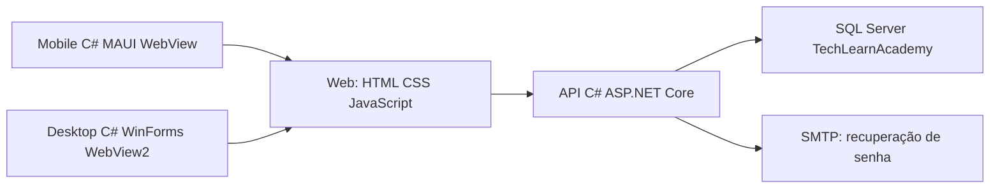
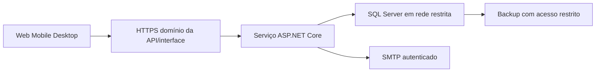

# TechLearn Academy — Relatório acadêmico do PIM IV

Atualização de 06/10/2026: consulte [novas-funcoes.md](novas-funcoes.md) para as regras atuais de chamados, certificados, perfis fixos, senhas e materiais. As descrições e evidências abaixo registram a versão anterior.

**Instituição:** [PREENCHER]  
**Curso:** [PREENCHER]  
**Disciplina / projeto:** PIM IV — [PREENCHER NOME OFICIAL]  
**Integrantes e matrículas:** Raphael [PREENCHER]; Luis [PREENCHER]; demais integrantes [PREENCHER]  
**Orientador(a):** [PREENCHER]  
**Cidade:** [PREENCHER]  
**Ano:** 2026

**Natureza do trabalho:** proposta e implementação acadêmica de uma plataforma integrada de cursos de programação.

Este texto é uma base de conteúdo acadêmico organizada em seções, resumo, referências e apêndices. A formatação final de capa, folha de rosto, margens, paginação, sumário e referências deve seguir o manual da instituição e as normas ABNT exigidas. Não se declara conformidade ABNT de um arquivo Markdown. Não foram inventados instituição, entrevistas, pesquisa de mercado, participantes ou resultados de testes.

## Resumo

A TechLearn Academy é uma proposta acadêmica de plataforma de cursos on-line de programação. O problema de referência é a distribuição de conteúdos, matrículas, avaliações e acompanhamento em ferramentas separadas, que pode gerar duplicação e dificuldade de controle. A solução integra os perfis Aluno, Mentor, Gestor e Administrador em um site responsivo, aplicativo mobile e programa desktop, ligados à mesma API C# com ASP.NET Core e ao SQL Server. O projeto organiza autenticação, recuperação de senha, conteúdos, matrículas, avaliações objetivas, resultados, progresso e mentoria. A implementação utiliza código direto e separação de responsabilidades. O banco é documentado com modelos, chaves, restrições, procedures e auditoria. O relatório também apresenta ações de inclusão, plano de nuvem/DevOps, planejamento ágil e cenários financeiros hipotéticos. Foram registrados 47 eventos de integração em SQL Server isolado e 22 verificações isoladas em C#, além de fluxos reais em navegador e restauração em banco novo. A confirmação operacional em dispositivos, SMTP externo e ambiente publicado permanece pendente. Estimativas financeiras e planejamento não constituem dados de uma empresa real.

**Palavras-chave:** educação; programação; API; acessibilidade; SQL Server.

## Sumário de conteúdo

1. Caracterização da organização e do problema.
2. Justificativa, objetivos e escopo.
3. Modelo operacional e de negócio.
4. Inclusão, diversidade e acessibilidade.
5. Arquitetura e decisões de implementação.
6. Segurança, privacidade e regras de negócio.
7. Banco e integridade dos dados.
8. Engenharia de software e gerenciamento ágil.
9. Nuvem, DevOps e continuidade.
10. Implantação e manutenção.
11. Verificação, limitações e evidências.
12. Conclusão.
13. Referências.
14. Apêndices e roteiro de apresentação.

## 1. Caracterização da organização e do problema

A TechLearn Academy representa uma organização **hipotética** de educação digital especializada em cursos de programação. Não há CNPJ, faturamento, estrutura de funcionários ou pesquisa com clientes reais comprovados nesta entrega. Esses campos devem ser preenchidos somente se o grupo produzir dados verificáveis.

Sua missão proposta é facilitar a aprendizagem de programação com conteúdos organizados, acompanhamento do progresso e orientação. A visão proposta é oferecer uma experiência consistente em computador e dispositivos móveis. Os valores definidos para o projeto são clareza, respeito, inclusão, proteção de dados e melhoria contínua.

O público considerado inclui estudantes, iniciantes, autodidatas, pessoas em transição de carreira, profissionais em aperfeiçoamento e pessoas com horários limitados. Esses grupos são o público-alvo definido no TXT, não uma amostra de pesquisa.

O cenário de referência utiliza planilhas, arquivos, links e mensagens separados. Uma matrícula pode ser repetida em duas planilhas; um aluno pode procurar um material em vários canais; o resultado de uma prova pode ser calculado manualmente; um mentor pode não encontrar o progresso atualizado. São exemplos de problemas possíveis que justificam a proposta, não ocorrências medidas em uma organização real.

## 2. Justificativa, objetivos e escopo

### 2.1 Justificativa

Centralizar os registros reduz a necessidade de copiar informações entre ferramentas. Uma única API aplica as regras a todos os clientes. O SQL Server mantém relacionamentos e impede determinados dados inválidos. A separação de perfis evita misturar gestão acadêmica com administração de contas.

O trabalho também permite aplicar as disciplinas de desenvolvimento web/mobile, arquitetura, banco, responsabilidade social, nuvem, DevOps e gerenciamento ágil. A escolha de código simples busca permitir que os integrantes expliquem o percurso de cada solicitação e entendam as decisões.

### 2.2 Objetivo geral

Construir uma solução acadêmica integrada de cursos de programação, com clientes web, mobile e desktop usando os mesmos dados e regras por uma API C# e banco SQL Server.

### 2.3 Objetivos específicos

- Cadastrar alunos e autenticar usuários reais, sem contas fixas de demonstração.
- Recuperar senha por e-mail com token temporário de uso único.
- Aplicar permissões de Aluno, Mentor, Gestor e Administrador no servidor.
- Organizar cursos, módulos e materiais em PDF ou links externos.
- Realizar matrículas sem duplicação e acompanhar módulos concluídos.
- Corrigir avaliações objetivas no servidor e apresentar nota, percentual e aprovação.
- Permitir mentoria restrita aos alunos vinculados.
- Produzir indicadores com definições claras para o gestor.
- Documentar integridade, acessibilidade, planejamento, implantação e limitações reais.

### 2.4 Limites do escopo

O projeto não oferece chat em tempo real, pagamentos internos, certificados, aulas ao vivo, inteligência artificial, transmissão própria de vídeos ou plataforma de streaming. Vídeos são acessados por links externos. Uma proposta de assinatura aparece apenas no modelo de negócio: o processamento de pagamentos não faz parte do sistema.

## 3. Modelo operacional e de negócio

### 3.1 Responsabilidades dos perfis

| Perfil | Responsabilidade |
|---|---|
| Aluno | Cadastro público, catálogo, matrícula, estudo, provas, resultados e progresso próprios. |
| Mentor | Alunos vinculados, histórico acadêmico e orientações registradas. |
| Gestor | Conteúdo acadêmico: cursos, módulos, materiais, avaliações e relatórios. |
| Administrador | Usuários, perfis, situação das contas e vínculos mentor/aluno. |

O cadastro público cria Aluno. Mentor, Gestor e Administrador são atribuídos por um administrador autenticado. O primeiro administrador precisa ser criado conscientemente pelo operador, fornecendo seus próprios dados e senha. Não existe uma senha administrativa universal no código.

### 3.2 Percurso operacional

O aluno cria a conta, entra, consulta um curso, matricula-se, estuda materiais, conclui módulos e responde avaliações. A API confere a matrícula e corrige a prova usando o gabarito do servidor. Os resultados são armazenados e apresentados ao aluno. O mentor vinculado consulta esse histórico e registra orientações. O gestor consulta as métricas e ajusta os conteúdos. O administrador mantém as contas e os vínculos.

Uma alteração criada pelo gestor no desktop aparece nos outros clientes porque todos consultam a API e o mesmo SQL Server. Isso depende de conectividade com o serviço hospedado; não existe sincronização de bancos locais nem modo offline nesta versão.

### 3.3 Quadro do modelo de negócio

| Elemento | Proposta acadêmica |
|---|---|
| Clientes | Pessoas interessadas em aprender programação. |
| Problema | Conteúdos, registros e acompanhamento dispersos. |
| Valor | Jornada organizada e acompanhada em um ambiente. |
| Produto | Plataforma de cursos por assinatura, com piloto gratuito possível. |
| Canais | Web, aplicativo mobile e programa desktop. |
| Relacionamento | Autoatendimento, progresso e orientação do mentor. |
| Receita | Assinatura periódica hipotética; cobrança externa ao sistema. |
| Recursos | API, banco, interface, conteúdos, equipe e infraestrutura. |
| Atividades | Produzir/revisar conteúdos, manter o serviço e acompanhar alunos. |
| Custos | Hospedagem, banco, domínio, e-mail, backup, conteúdo e suporte. |
| Parceiros possíveis | Instrutores, produtores de conteúdo e provedores de infraestrutura. |

### 3.4 Viabilidade técnica e operacional

A arquitetura usa tecnologias compatíveis e uma única regra de negócio para os três clientes. A viabilidade técnica ainda exige validar instalações, conectividade, cargas, certificados e publicação. A viabilidade operacional depende de conteúdos adequados, pessoal para orientação e suporte e acompanhamento de métricas. A correção automática economiza uma etapa manual, mas não substitui o trabalho pedagógico de preparar questões e explicar respostas.

### 3.5 Estimativas financeiras transparentes

Os números abaixo são **hipóteses didáticas em reais**, sem cotação de fornecedor, pesquisa com clientes ou garantia de preços. Não são valores oficiais de nuvem. Antes de uma decisão de negócio, obter propostas, medir uso, considerar tributos, licenças, encargos, inadimplência e custo do trabalho.

| Custo fixo mensal proposto | Estimativa |
|---|---:|
| Hospedagem da API/interface | R$ 180,00 |
| Serviço SQL Server | R$ 300,00 |
| Serviço de e-mail | R$ 50,00 |
| Domínio, distribuído por mês | R$ 10,00 |
| Armazenamento de backup | R$ 60,00 |
| Conteúdo e manutenção técnica | R$ 800,00 |
| Suporte/rotina administrativa | R$ 400,00 |
| **Total fixo F** | **R$ 1.800,00** |

Hipótese de assinatura `P = R$ 29,90` por mês. Hipótese de custo variável `V = R$ 3,00` por assinante/mês. Esse valor representa consumo adicional e suporte variável; não presume integração de cobrança no produto.

`Receita = P × quantidade de assinantes`  
`Custo mensal = F + V × quantidade de assinantes`  
`Resultado simplificado = receita − custo mensal`  
`Ponto de equilíbrio = arredondar para cima F / (P − V)`

No exemplo, a contribuição por assinante é R$ 26,90 e `1800 / 26,90 = 66,91`. Portanto, o equilíbrio simplificado exige **67 assinantes pagantes**, mantidas as hipóteses.

| Cenário hipotético | Assinantes | Receita | Custo | Resultado simplificado |
|---|---:|---:|---:|---:|
| Conservador | 30 | R$ 897,00 | R$ 1.890,00 | −R$ 993,00 |
| Intermediário | 80 | R$ 2.392,00 | R$ 2.040,00 | R$ 352,00 |
| Expansão | 150 | R$ 4.485,00 | R$ 2.250,00 | R$ 2.235,00 |

Um piloto gratuito de 30 participantes teria receita zero e custo estimado de R$ 1.890,00 por mês nesse modelo. Seria necessário definir quem financia esse custo. Um investimento inicial hipotético de R$ 6.000,00 para preparação e implantação não está incluído no ponto de equilíbrio mensal. Sem dados reais de demanda, retenção, custo e tributos, não se pode concluir que o negócio será lucrativo.

## 4. Inclusão, diversidade e acessibilidade

### 4.1 Ações concretas de responsabilidade social

O sistema não solicita raça, gênero ou origem para autorizar acesso. A permissão depende da função acadêmica e da identidade autenticada. A equipe deve revisar exemplos, textos e materiais para evitar estereótipos e incluir contribuições de diferentes grupos. Conteúdos externos precisam de avaliação de qualidade e acessibilidade antes da publicação.

O piloto pode oferecer participação gratuita e orientação a pessoas iniciantes, com critérios públicos de seleção e sem discriminação. Isso é uma proposta operacional, não um programa social já realizado. Para demonstrar impacto, registrar número de participantes com autorização, dificuldades encontradas e melhorias, usando dados agregados e sem expor pessoas.

Textos curtos, nomenclatura consistente, caminhos claros de retorno e mensagens de erro ajudam pessoas com diferentes níveis de familiaridade digital. A interface responsiva reduz a dependência de um computador de mesa. A dependência de conexão permanece uma limitação: não se deve prometer funcionamento sem internet.

### 4.2 Critérios de acessibilidade para conferência

O trabalho usa rótulos associados aos campos, títulos organizados, botões com texto, foco visível e mensagens anunciáveis. A conferência deve incluir teclado, leitor de tela, zoom e telas menores. A referência adotada para esses critérios é a [WCAG 2.2 do W3C](https://www.w3.org/TR/WCAG22/): contraste de texto normal de pelo menos 4,5:1, operação por teclado e ampliação de texto sem perda de informação. Não se declara conformidade integral sem uma auditoria dos critérios aplicáveis.

| Ação do projeto | Verificação a realizar |
|---|---|
| Labels e autocomplete | Conferir nome acessível e finalidade de cada input. |
| Mensagens com suporte a leitor de tela | Conferir anúncio de erro/sucesso, sem depender apenas de cor. |
| Foco visível | Percorrer links/formulários com Tab e Shift+Tab. |
| Layout responsivo | Conferir 320 px, tablet, desktop e zoom de 200%. |
| Conteúdo externo | Exigir PDFs legíveis e alternativas/legendas pertinentes nos materiais publicados. |
| Linguagem inclusiva | Revisão pedagógica com exemplos diversos e termos respeitosos. |

## 5. Arquitetura e decisões de implementação

### 5.1 Estrutura geral

Mobile e desktop hospedam a interface web responsiva em controles WebView. As solicitações de dados continuam chegando à mesma API. O projeto web separado é uma prévia estática; a execução integrada é oferecida pela API, que publica os arquivos web na mesma origem. Isso simplifica cookies e elimina configurações duplicadas de endereço em cada chamada JavaScript.

### 5.2 Camadas da API

| Pasta/parte | Função didática |
|---|---|
| Controllers | Receber a requisição e devolver a resposta HTTP. |
| Servicos | Conferir dados, identidade e regras de negócio. |
| Banco | Abrir a conexão e executar SQL com parâmetros. |
| Modelos | Representar os dados recebidos em cada operação. |
| Program.cs | Configurar serviços, autenticação, erros e publicação da interface. |
| appsettings.json / variáveis de ambiente | Configurar conexão e SMTP sem colocar credenciais no cliente. |
| Banco da raiz | Scripts SQL e operação de backup/restauração. |
| TechLearnAcademy.Tests | Projeto console C# com verificações isoladas das regras, sem banco. |

Fala simples: “O controller recebe. O serviço decide. O banco consulta ou grava.” Essa divisão separa responsabilidades sem introduzir arquiteturas de múltiplos serviços ou padrões sem necessidade acadêmica.

### 5.3 Por que WebView nos aplicativos

O controle [WebView do .NET MAUI](https://learn.microsoft.com/en-us/dotnet/maui/user-interface/controls/webview?view=net-maui-10.0) permite apresentar conteúdo web no aplicativo. O [WebView2 em Windows Forms](https://learn.microsoft.com/en-us/microsoft-edge/webview2/get-started/winforms) oferece essa apresentação no programa Windows. Nesta solução, os controles C# abrem a interface hospedada e responsiva. O endereço é configurável.

Essa decisão reduz a repetição de formulários, validações e manutenção entre três interfaces. Ela é uma adaptação da experiência web em aplicativos C#, não três interfaces nativas independentes. Não acrescenta acesso direto ao SQL. É necessário confirmar com a instituição que essa abordagem atende ao requisito de desenvolvimento mobile e testar em dispositivo/emulador; não se presume aprovação acadêmica antecipada.

Limitações: dependência de rede, infraestrutura da interface/API, comportamento do navegador embutido, componentes instalados e restrições de certificados nos dispositivos. O runtime WebView2 é uma dependência do desktop; workloads e SDKs são dependências de compilação do MAUI. Eles não são frameworks JavaScript adicionados ao site.

### 5.4 Exemplo de matrícula

1. O aluno autenticado escolhe “Matricular-se”.
2. JavaScript envia `POST /api/matriculas` com CursoId, usando JSON.
3. A autenticação do servidor reconhece a sessão válida; o serviço verifica a permissão.
4. `sp_RealizarMatricula` verifica aluno/curso e impede duplicação concorrente.
5. A API responde; o cliente apresenta a confirmação ou o erro real.

## 6. Segurança, privacidade e regras de negócio

### 6.1 Autenticação e autorização

Autenticação identifica a pessoa; autorização decide o que ela pode acessar. A documentação de [autenticação do ASP.NET Core](https://learn.microsoft.com/en-us/aspnet/core/security/authentication/?view=aspnetcore-10.0) distingue esses processos. A solução usa uma sessão real, consultada no servidor, e autorizações nos endpoints. Não depende apenas de esconder botões.

No login, a API confere a senha contra o hash, gera um token aleatório, guarda somente seu SHA-256 em Sessoes e entrega um cookie `TechLearnSessao` HttpOnly. O cookie é Secure quando a requisição usa HTTPS, possui SameSite Strict e duração de até oito horas no código atual. O handler consulta validade/revogação e situação da conta a cada autenticação. O JSON também devolve o token conforme o contrato; a interface não o coloca em localStorage/sessionStorage.

HttpOnly impede a leitura do cookie por JavaScript, mas não torna todo o sistema invulnerável. É necessário usar HTTPS na publicação, controlar origens, manter validação no servidor, evitar inserir HTML recebido e revisar ataques de requisição entre sites. Arquivos HTML podem ser abertos diretamente; o que precisa estar protegido são os dados e ações dos endpoints.

### 6.2 Senhas e recuperação

A regra desta solução nova foi unificada: mínimo de 15 caracteres, letra maiúscula, número e símbolo, com espaços preservados. Não é copiada a regra antiga de oito caracteres. A API usa PBKDF2 para produzir hash com salt; a [API de PBKDF2 do .NET](https://learn.microsoft.com/en-us/dotnet/api/system.security.cryptography.rfc2898derivebytes.pbkdf2?view=net-10.0) descreve o recurso usado. Não se armazena a senha digitada nem uma senha administrativa fixa.

Recuperação envia um link por SMTP para uma conta ativa. O token possui 30 minutos, hash no banco e uso único. A operação de redefinição bloqueia/consome o token e altera a senha na mesma transação; também revoga sessões existentes. SMTP não configurado produz erro de serviço indisponível, e uma falha de envio não é apresentada como sucesso. Não há exposição pública do token para “facilitar” um teste.

### 6.3 Privacidade e LGPD

Nome, e-mail, vínculos, orientações e histórico acadêmico são dados pessoais usados neste projeto. A [Lei nº 13.709/2018, no Planalto](https://www.planalto.gov.br/ccivil_03/_ato2015-2018/2018/lei/l13709.htm), é a referência legal sobre proteção de dados. Antes de uma operação real, a organização precisa definir finalidade, base legal, responsáveis, prazos de retenção, atendimento aos titulares e resposta a incidentes. Não se afirma que o protótipo sozinho assegura conformidade legal.

Plano operacional proposto: coletar apenas dados necessários, restringir consulta ao perfil autorizado, publicar aviso de privacidade compreensível, manter canal de solicitações e revisar retenção. A exclusão/anonimização deve considerar o histórico acadêmico e obrigações aplicáveis; desativar conta não equivale automaticamente a apagar dados. Consentimento não será presumido como base universal. Uso por menores exige análise própria antes de abrir o piloto.

Logs não devem registrar senhas, tokens completos nem conteúdo desnecessário de orientações. Backups também contêm dados pessoais e precisam de controle de acesso. A equipe deve documentar responsáveis e procedimentos antes da publicação.

## 7. Banco e integridade dos dados

A documentação detalhada está em `Documentacao/banco.md`. Há 15 tabelas previstas no TXT e uma tabela técnica de sessões, totalizando 16. Usuarios reúne todos os perfis; não existe tabela separada Alunos.

| Grupo | Tabelas |
|---|---|
| Identidade | Usuarios, RecuperacoesSenha, Sessoes, AuditoriaUsuarios. |
| Conteúdo | Cursos, Modulos, Materiais, Avaliacoes, Questoes, Alternativas. |
| Jornada acadêmica | Matriculas, TentativasAvaliacao, RespostasAluno, ProgressoModulos. |
| Mentoria | AcompanhamentosMentor, OrientacoesMentor. |

Chaves estrangeiras mantêm relacionamentos. E-mail é único. Um índice filtrado impede duas matrículas ativas do mesmo aluno no mesmo curso. Chaves compostas em RespostasAluno impedem selecionar alternativa de outra questão ou combinar questão e tentativa de provas diferentes. Um índice permite no máximo uma alternativa correta; a API valida pelo menos duas alternativas e exatamente uma correta antes de gravar a questão em transação.

Nota = acertos / total × 10. Percentual = acertos / total × 100. Ambos são arredondados para duas casas; aprovação mínima de 60%. O banco confere esses valores por CHECK. O progresso usa módulos ativos concluídos sobre o total de módulos ativos. Registros relacionados são desativados, preservando histórico.

`sp_RealizarMatricula` usa transação/bloqueios para impedir duplicação concorrente. `sp_RelatorioCurso` calcula matrículas ativas, média das notas de todas as tentativas, taxa de tentativas aprovadas e progresso médio dos matriculados. `tr_AuditoriaUsuarios` registra alterações de perfil/situação, sem copiar senha/token. Essas definições evitam chamar média por tentativa de “média de pessoas”.

## 8. Engenharia de software e gerenciamento ágil

### 8.1 Método de trabalho proposto

O [Scrum Guide oficial](https://scrumguides.org/scrum-guide.html) serve de referência para organizar objetivos, backlog, inspeção e adaptação. O grupo propõe ciclos curtos com planejamento, acompanhamento, revisão e retrospectiva. Este documento é um plano inspirado em Scrum, não comprovação de que todos os eventos foram realizados.

Responsabilidades propostas: Raphael coordena interface/experiência; Luis coordena API/banco; demais integrantes assumem testes, documentação e revisão conforme preenchimento do quadro do grupo. Uma pessoa responsável pelo produto prioriza o backlog; a responsabilidade de facilitação pode ser combinada pelo grupo. Não se atribuem cargos reais a integrantes sem confirmação.

### 8.2 Backlog priorizado

| Item | Entrega | Prioridade | Critério de aceite resumido |
|---|---|---|---|
| B01 | Estrutura e contrato | Alta | Projetos separados; antigo preservado; rotas documentadas. |
| B02 | Banco completo | Alta | 16 tabelas, chaves, procedures, trigger, dicionário. |
| B03 | Identidade | Alta | Cadastro Aluno, login real, token, autorização e logout. |
| B04 | Recuperação | Alta | SMTP, validade/uso único e falhas claras. |
| B05 | Conteúdo acadêmico | Alta | Gestor cria/edita/desativa cursos, módulos e materiais. |
| B06 | Matrícula e estudo | Alta | Aluno matriculado consulta materiais e registra progresso. |
| B07 | Avaliações | Alta | Questões válidas; correção no servidor; histórico protegido. |
| B08 | Mentoria | Alta | Vínculos reais; mentor vê somente seus alunos/orientações. |
| B09 | Gestão e administração | Alta | Relatórios definidos; contas/perfis administrados com auditoria. |
| B10 | Mobile e desktop | Alta | Aplicativos C# abrem a interface/API configurada; sem SQL direto. |
| B11 | Acessibilidade | Alta | Rótulos, foco, teclado, mensagens e layout conferidos. |
| B12 | Nuvem/DevOps/continuidade | Média | Configuração, pipeline, backup e restauração descritos. |
| B13 | Verificação/relatório final | Alta | Evidências reais, limitações e referências, sem dados inventados. |

### 8.3 Sprints propostas

Cada sprint abaixo tem duração proposta de uma semana, a ajustar ao calendário acadêmico. Não representa horas ou datas de execução já comprovadas.

| Sprint | Objetivo | Itens | Evidência a registrar |
|---|---|---|---|
| 1 | Base e identidade | B01, B02, B03 | Compilação, scripts revisados, cadastro/login com banco isolado. |
| 2 | Recuperação e conteúdo | B04, B05 | SMTP real; criação de curso/módulo/material por Gestor. |
| 3 | Jornada e provas | B06, B07 | Matrícula concorrente, conteúdo protegido e correção real. |
| 4 | Outros perfis | B08, B09 | Mentor restrito, relatório e auditoria de usuários. |
| 5 | Clientes e acessibilidade | B10, B11 | Emulador/aparelho, desktop, teclado e responsividade. |
| 6 | Operação e entrega | B12, B13 | Backup restaurado em teste, pipeline, documentação/banca. |

Ao final de cada ciclo, revisar o que realmente funcionou, bugs, riscos e dependências. Se a infraestrutura impedir a demonstração, registrar “pendente”, responsável e próxima ação. Não mover uma tarefa para concluída somente porque existe uma tela.

### 8.4 Definition of Done / definição de pronto

- Código organizado, comentários objetivos e regra compreensível pelo grupo.
- Contrato de entrada/saída respeitado e validação também no servidor.
- Permissões e propriedade dos dados conferidas onde se aplicam.
- Compilação/verificação apropriada realizada, ou limitação explicitamente registrada.
- Sem credenciais, senhas/token em logs ou dados fictícios apresentados como reais.
- Rótulos, erros, foco, telas menores e estado vazio conferidos.
- Documentação, scripts e matriz atualizados.
- Evidência de execução com data/ambiente/resultado somente quando realmente produzida.

### 8.5 Riscos e mitigação

| Risco | Ação proposta |
|---|---|
| Escopo grande para iniciantes | Funções pequenas, contrato único, revisão por módulo e explicação na banca. |
| API/SQL/SMTP ausentes | Configuração separada; falha clara; nenhuma resposta fictícia. |
| Regras diferentes entre clientes | Interface compartilhada e validação central no servidor. |
| Conteúdo inacessível | Revisão pedagógica; PDFs legíveis e links com alternativas apropriadas. |
| Perda de dados | Backup isolado e restauração de teste. |
| MAUI/WebView não aceito no curso | Confirmar tecnologia com orientador e registrar decisão antes da apresentação. |
| Custos crescentes | Medir uso/assinantes e reestimar, sem assumir que exemplos são preços reais. |

## 9. Nuvem, DevOps e continuidade

### 9.1 Implantação proposta

Publicar a API e a interface web em um serviço compatível com ASP.NET Core, com HTTPS e domínio. Manter SQL Server em serviço gerenciado ou servidor dedicado com acesso limitado à API. Configurar SMTP, backups, logs e segredos fora do repositório. Não publicar SQL para acesso dos navegadores/aplicativos.

Esse desenho é uma proposta de publicação, não ambiente de nuvem contratado ou já ativo. A escolha do provedor deve considerar compatibilidade, região, proteção de dados, licenças, disponibilidade e orçamento medido. Não se afirma distribuição geográfica ou alta disponibilidade sem configuração/evidência.

### 9.2 Plano DevOps

Git mantém código e scripts versionados. Pull requests permitem revisão antes da integração. Uma automação de CI deve restaurar dependências, compilar projetos suportados e executar testes que não necessitam de produção. A documentação oficial de [GitHub Actions](https://docs.github.com/en/actions/get-started/understand-github-actions) descreve workflows usados para automatizar essas etapas. Publicação e migração de banco devem exigir decisão do responsável e backup prévio.

Separar desenvolvimento, homologação e produção; cada ambiente tem conexão, SMTP e segredos próprios. Guardar configuração sensível em variáveis/segredos do serviço. Validar health/status sem devolver senha de conexão. Registrar erro e identificador de operação com cuidado para não expor dados pessoais. Monitorar indisponibilidade, falhas de autenticação e consumo.

### 9.3 Backup e recuperação

A referência técnica é a documentação de [backup e restauração do SQL Server](https://learn.microsoft.com/en-us/sql/relational-databases/backup-restore/back-up-and-restore-of-sql-server-databases?view=sql-server-ver17). A entrega inclui modelos de backup COPY_ONLY/CHECKSUM e restauração em banco novo. Em teste isolado, o backup passou no VERIFYONLY e foi restaurado em **TechLearnAcademy_Restauracao**, sem substituir o original; foram encontrados 10 usuários na origem e 10 na cópia. Isso comprova a restauração e essa comparação. CHECKDB, demais tabelas e fluxos da aplicação apontando para a cópia ainda precisam ser conferidos. Backup legível não prova sozinho recuperação completa do serviço.

Plano inicial proposto: backup completo diário, retenção de 30 dias, cópia protegida fora do servidor e teste mensal de restauração. Objetivos preliminares para discussão: perda máxima de até 24 horas de dados (RPO) e retomada em até quatro horas (RTO). Esses números são metas, não resultados medidos nem garantias contratuais. O piloto precisa cronometrar a recuperação para validar/revisar os objetivos.

## 10. Implantação e manutenção

### 10.1 Preparação do ambiente

Instalar ferramentas compatíveis: Visual Studio/.NET 10, SQL Server/SSMS, workloads MAUI/SDKs dos alvos e runtime WebView2 para desktop. Usar uma instância SQL **nova e isolada**, executar o script do banco no modo SQLCMD e configurar a API nova. Não reutilizar nem substituir o banco de desenvolvimento antigo.

Configurar HTTPS e SMTP reais, cadastrar o primeiro administrador por comando explícito com dados do operador e criar os demais perfis pelo sistema. Um Gestor cadastra conteúdos reais, e um Administrador cria os vínculos mentor/aluno. A ausência de dados deve gerar listas vazias com explicação, não cursos de demonstração automáticos.

No mesmo computador, localhost identifica a máquina do teste. Em celular físico, localhost identifica o próprio celular: usar o endereço acessível da API/interface na rede, com certificado confiável e regras de acesso apropriadas. Não remover validação TLS nem abrir indiscriminadamente a rede para contornar erros.

### 10.2 Manutenção

Antes de atualizar, revisar alterações, criar backup e testar em homologação. Atualizar API/interface em conjunto quando houver mudança de contrato. Mudanças do banco precisam de script versionado específico, revisão e plano de retorno. O script inicial de criação não é uma migração para banco existente.

Revisar periodicamente conteúdos/links, acessibilidade, contas inativas, sessões expiradas, permissões, registros de falha e retenção de dados. Documentar o procedimento de suporte sem pedir senha aos usuários. Se um link externo deixar de funcionar, o Gestor corrige/desativa o material.

## 11. Verificação, limitações e evidências

Este relatório descreve código, contrato, verificações planejadas e resultados realmente registrados na instância isolada de testes. A cobertura comprovada deve ser consultada em `Documentacao/testes-executados.md`; não se presume validação de todos os fluxos ou ambientes.

`Documentacao/requisitos.md` associa cada item do TXT a tela, rota, script ou documentação, com cenário de aceite e tabela de cobertura real. A instância SQL e o receptor SMTP locais foram exercitados; os cenários restantes e as dependências externas não comprovadas permanecem identificados.

Na verificação de 4 out. 2026, a API foi executada em HTTP Development, endereço de loopback, com uma instância LocalDB exclusiva de testes. Foram registrados **30 eventos aprovados em `Testes/evidencias/integracao.json` e 17 em `Testes/evidencias/adicionais.json`**, totalizando **47 eventos de integração real**. O projeto console **TechLearnAcademy.Tests** executou **22 verificações isoladas em C#** de validação, hash, espaços da senha, tokens, nome, e-mail e URL. A soma é **69 verificações registradas**, não 69 requisitos integralmente validados. Alguns eventos de integração agrupam várias chamadas HTTP.

Os eventos incluem cadastro sempre Aluno, e-mail duplicado, senha incorreta/curta, permissões, matrícula sequencial e concorrente, material restrito a matriculado, gabarito, resultado/progresso, mentor vinculado, relatório, último administrador, inativação, recuperação e logout. Também foram comprovados reprovação com 2/5 acertos, aprovação no limite exato de 3/5 = 60%, arredondamento de 1/32 para 3,13% e nota 0,31, recusa de questão repetida/alternativa de outra questão, ausência de tentativa parcial e preservação do histórico após edição recusada ou desativação. A matrícula concorrente produziu uma resposta 201 e outra 409; o SQL conservou uma única matrícula ativa. Hash e auditoria foram consultados no SQL real, sem acessar o banco antigo.

A primeira execução do esquema revelou a necessidade de configurar opções SET para os índices filtrados. Depois da correção, o arquivo completo foi executado do início ao fim, sem complemento, no novo banco vazio **TechLearnAcademyValidacao20261004**, na instância isolada, alterando somente o nome do banco na cópia de teste. Foram conferidas **16 tabelas, 19 índices adicionais, duas procedures e uma trigger**. As procedures e a trigger foram exercitadas pela integração. O backup COPY_ONLY/CHECKSUM passou no VERIFYONLY e foi restaurado no novo **TechLearnAcademy_Restauracao**, com 10 usuários na origem e 10 na cópia. CHECKDB, todas as tabelas e uso da cópia pela aplicação ainda não foram comprovados.

O SMTP usado era um receptor local de teste. A API enviou uma mensagem SMTP real, cujo link foi lido pelo teste para executar redefinição, uso único e expiração. SMTP sem configuração também retornou 503 sem sucesso fictício. Isso não comprova entrega a uma caixa de e-mail externa, autenticação/TLS de um provedor público ou acesso IMAP. API, Web, Tests, desktop Windows, MAUI Android e MAUI Windows foram compilados sem erros/avisos, inclusive na compilação final da solução com cinco projetos. Foram conferidos 24 HTMLs via HTTP 200, sintaxe de oito arquivos JavaScript, 157 links e 42 rótulos. A compilação sozinha não comprova execução dos aplicativos em aparelho ou emulador.

O comando **--criar-admin** foi executado no novo banco de validação: recebeu os dados informados pelo operador e criou um administrador. A segunda execução foi recusada com “Já existe um Administrador ativo...” e código de saída 1, sem criar outra conta. O pacote Release da API também foi publicado localmente e executado em Development: 24 HTMLs, página inicial e cadastro responderam 200; a rota administrativa de status do banco sem sessão respondeu 401, como esperado. Esses testes de comando, navegador, compilação e publicação local são evidências adicionais e **não entram na contagem das 69 verificações das suites**. Publicação local não significa implantação em nuvem ou IIS.

Em navegador foram executados cadastro real, login incorreto/correto, matrícula, listagem de material, resposta de avaliação, resultado real com nota 10/100%, progresso e logout do Aluno. O direcionamento e a abertura dos painéis **Aluno, Mentor, Gestor e Administrador**, com dados da API, também foram conferidos, assim como a saída de cada perfil. Para isso, o perfil da conta de teste foi alterado somente no SQL isolado. A largura de 390 px não apresentou transbordamento horizontal; houve uma conferência inicial do foco por Tab. Prints reais foram registrados. Esses percursos não equivalem a validar todas as operações de cada tela ou todos os critérios de acessibilidade.

Continuam pendentes: demais controles e percursos de gestão, edição e desativação no navegador, execução nativa desktop e MAUI em dispositivos/emulador, SMTP externo, publicação HTTPS/nuvem/IIS, CI em serviço externo, consumo concorrente da recuperação, demais cenários ausentes nos eventos, auditoria com leitor de tela/teclado/zoom e desempenho sob carga. A restauração executada ainda precisa de CHECKDB e percurso da aplicação na cópia. O registro detalhado de testes diferencia cobertura parcial de requisito integralmente validado. Para novas execuções, registrar data, versão/commit, ambiente, passos, esperado e observado, sem dados sensíveis. Respostas simuladas não substituem a integração real.

## 12. Conclusão

A solução proposta reúne os quatro perfis e organiza a jornada de cursos de programação com uma API e um banco compartilhados. A implementação prioriza clareza, regras no servidor, integridade e reutilização de interface. Os aplicativos C# apresentam a experiência responsiva hospedada, reduzindo repetição e mantendo a mesma origem dos dados.

A entrega acadêmica distingue artefatos preparados dos **47 eventos de integração e 22 verificações C# aprovados**, do percurso do Aluno e direcionamento dos quatro perfis em navegador, da criação integral do esquema corrigido e da restauração em banco novo. Esses resultados locais não certificam todos os requisitos nem uma operação pública. Aplicativos em execução nativa, SMTP externo, publicação, controles visuais restantes, recuperação completa e desempenho ainda precisam de confirmação. As ações de inclusão, o plano de continuidade e as estimativas de negócio devem ser revisados com evidências antes de uma operação pública.

## 13. Referências primárias consultadas

Data de consulta: **4 out. 2026**. Os links abaixo foram consultados como fontes primárias técnicas/legais. O conteúdo do TXT e `CONTRATO.md` é material interno de definição do projeto, não pesquisa publicada.

BRASIL. **Lei nº 13.709, de 14 de agosto de 2018 — Lei Geral de Proteção de Dados Pessoais**. Disponível em: [Planalto](https://www.planalto.gov.br/ccivil_03/_ato2015-2018/2018/lei/l13709.htm). Acesso em: 4 out. 2026.

GITHUB. **Understanding GitHub Actions**. Disponível em: [GitHub Docs](https://docs.github.com/en/actions/get-started/understand-github-actions). Acesso em: 4 out. 2026.

MICROSOFT. **Overview of ASP.NET Core authentication**. Disponível em: [Microsoft Learn](https://learn.microsoft.com/en-us/aspnet/core/security/authentication/?view=aspnetcore-10.0). Acesso em: 4 out. 2026.

MICROSOFT. **WebView — .NET MAUI**. Disponível em: [Microsoft Learn](https://learn.microsoft.com/en-us/dotnet/maui/user-interface/controls/webview?view=net-maui-10.0). Acesso em: 4 out. 2026.

MICROSOFT. **Get started with WebView2 in WinForms apps**. Disponível em: [Microsoft Learn](https://learn.microsoft.com/en-us/microsoft-edge/webview2/get-started/winforms). Acesso em: 4 out. 2026.

MICROSOFT. **Rfc2898DeriveBytes.Pbkdf2 Method**. Disponível em: [Microsoft Learn](https://learn.microsoft.com/en-us/dotnet/api/system.security.cryptography.rfc2898derivebytes.pbkdf2?view=net-10.0). Acesso em: 4 out. 2026.

MICROSOFT. **Back up and restore of SQL Server databases**. Disponível em: [Microsoft Learn](https://learn.microsoft.com/en-us/sql/relational-databases/backup-restore/back-up-and-restore-of-sql-server-databases?view=sql-server-ver17). Acesso em: 4 out. 2026.

SCHWABER, Ken; SUTHERLAND, Jeff. **The Scrum Guide**. 2020. Disponível em: [Scrum Guides](https://scrumguides.org/scrum-guide.html). Acesso em: 4 out. 2026.

W3C. **Web Content Accessibility Guidelines (WCAG) 2.2**. Disponível em: [W3C](https://www.w3.org/TR/WCAG22/). Acesso em: 4 out. 2026.

## 14. Apêndices e roteiro didático

### 14.1 Artefatos que acompanham o texto

- `CONTRATO.md`: nomes das rotas, entradas, saídas e decisões comuns.
- `Documentacao/requisitos.md`: rastreabilidade do TXT e critérios de aceite.
- `Documentacao/banco.md`: MER, modelos, dicionário e explicação das procedures/trigger.
- `Banco/01-criar-banco.sql`: estrutura completa do banco novo.
- `Banco/02-backup.sql` e `Banco/03-restaurar-teste.sql`: operação segura proposta.
- Projetos Api, Web, Mobile, Desktop e Tests: implementação e verificações da solução nova.

### 14.2 Falas curtas para a banca

“O problema é ter conteúdo, matrícula e resultado em lugares separados. Nossa proposta reúne esses registros.”

“Temos quatro perfis. Aluno estuda; Mentor acompanha; Gestor cuida do conteúdo; Administrador cuida das contas e acessos.”

“HTML organiza a tela. CSS dá aparência e adapta o tamanho. JavaScript envia solicitações e mostra as respostas da API.”

“Os aplicativos C# abrem a interface responsiva em uma WebView. Assim repetimos menos código e usamos a mesma API.”

“O controller recebe o pedido. O serviço verifica as regras. A parte de banco executa SQL com parâmetros.”

“A senha não fica em texto puro. O token é temporário e é conferido pelo servidor. Esconder botões não é a proteção.”

“A matrícula usa uma procedure para evitar duplicação. A auditoria usa uma trigger para registrar mudanças de perfil e situação.”

“Os números financeiros são hipóteses do trabalho. Ainda não fizemos pesquisa para provar demanda ou lucro.”

“Para cada teste mostramos o que realmente foi executado. SQL, e-mail e aparelhos precisam de ambiente configurado; não inventamos sucesso quando uma dependência falta.”
