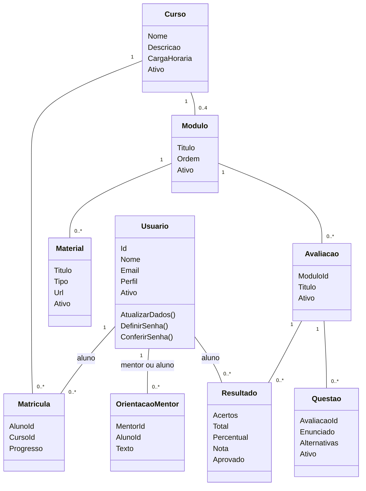

# As nove classes do projeto

No Visual Studio, abra **TechLearnAcademy.Api → Modelos**.

| Classe | Responsabilidade |
| --- | --- |
| Usuario | Representa uma pessoa e seu perfil: Aluno, Mentor, Gestor ou Administrador. Valida dados e senha. |
| Curso | Representa um curso e valida nome, descrição e carga horária. |
| Modulo | Representa uma divisão do curso e valida título e ordem. |
| Material | Representa um PDF ou link e valida seu endereço. |
| Matricula | Liga aluno e curso e guarda o progresso calculado. |
| Avaliacao | Representa a avaliação de um módulo e valida o título. |
| Questao | Reúne enunciado, alternativas e indicação da resposta correta. |
| Resultado | Calcula acertos, percentual, nota e aprovação. |
| OrientacaoMentor | Liga mentor e aluno ao texto da orientação. |

## Diagrama de classes para a apresentação

Este é o diagrama do sistema, com as nove classes. As relações representam as relações guardadas pelos identificadores no banco.

## Como explicar

Uma classe reúne os dados e comportamentos de uma parte do sistema. Por exemplo, Usuario guarda Nome e Email e oferece o método AtualizarDados, que verifica esses dados antes de alterá-los.

O campo Perfil de Usuario informa se a pessoa é Aluno, Mentor, Gestor ou Administrador. O cadastro público cria um aluno. As permissões continuam sendo verificadas pela API. Os quatro perfis usam a mesma classe.

Questao guarda as alternativas como uma lista de textos com a indicação Correta. A validação exige de duas a cinco alternativas e exatamente uma correta. Resultado calcula a nota; a aprovação continua sendo a partir de 60%.

Matricula representa o vínculo entre aluno e curso. Seu Progresso é calculado a partir dos módulos concluídos, sem mudar a estrutura do banco.

As nove classes usam as tabelas já existentes. Questao reúne dados de Questoes e Alternativas; Resultado reúne dados de TentativasAvaliacao e RespostasAluno. A correspondência completa está em banco.md. Não é necessário ter uma tabela para cada classe.

## Arquivos de apoio

Pedidos.cs reúne estruturas com os campos enviados pelos formulários, como nome e senha do cadastro. Esses dados de entrada não são outras classes de negócio e não precisam ser incluídos neste diagrama.

Os controllers recebem os pedidos, os serviços coordenam as operações e ConexaoBanco executa o SQL. São suporte técnico ao funcionamento do site. O diagrama principal apresenta as nove classes acima.

## Executar

Inicie TechLearnAcademy.Api com F5, como antes. As novas funções exigem a atualização SQL de Banco/05-atualizar-funcionalidades.sql. Essa atualização já foi aplicada ao banco local em 06/10/2026. Não é necessário recriar contas.

Para conferir as regras sem acessar o banco, execute na pasta da solução:

    dotnet run --project TechLearnAcademy.Tests

## Novas funções

Chamados, mensagens e certificados são coordenados pelo GestaoServico, usando tabelas de apoio. Mantivemos as nove classes principais do diagrama. Consulte [Guia das novas funções](novas-funcoes.md).
